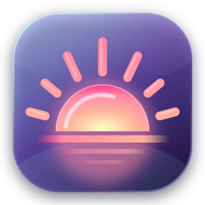

# doepic.ai

**Personal project showcase: apps, services and experiments that feel good to use.**

[Open the site](https://doepic.ai)

A static site with no build step and no third-party scripts, served by GitHub Pages. The interface is available in English and Russian.

## Design

Current: **Four Seasons Low-Poly**. A dawn city whose four seasons change as you scroll (spring → summer → autumn → winter): shore trees, colour grading and petals, fireflies, leaves and snow. Palette: `#051f39 #28225d #4a2480 #882f8f #c53a9d #e2648f #ff8e80 #ffa4a4`.

The previous design, **Dawn City**, was 3D glass over layered scenery (sky, sun, three city layers, water, glass sprites).

Earlier designs can be restored from git:

| Design | Tag | Branch |
|---|---|---|
| Glass 3D (v1) | `design-glass-v1` | `design/glass-v1` |
| Sunset, flat (v2) | `design-sunset-v2` | `design/sunset-v2` |

To preview one: `git checkout design-sunset-v2` (to return: `git checkout main`).
To put it back on the site: `git checkout design-sunset-v2 -- index.html img/social.png`, then commit and push.

## Artwork (Gemini, low-poly)

The scene is light: CSS draws the sky and water, and the rest is 8 low-poly images generated with Gemini, about 400 KB in total (down from 3.6 MB). The first screen loads about 190 KB: sun, hills, two city layers and the spring shore. The other three shores load when the browser is idle.

How artwork is produced (the standard path for any new image):

1. `python tools/receiver.py 8777` starts a receiver on 127.0.0.1. It prints a token on startup and accepts images only.
2. The image is generated in Gemini in the built-in browser. The Gemini page does not allow `fetch` to other origins, so the image is drawn to a canvas, base64-encoded and passed in the URL fragment to `http://127.0.0.1:8777/recv.html#name.ext.data`. The receiver page saves the file to `gemini-raw/`.
3. `python tools/import_gemini.py` (Pillow, NumPy, SciPy) removes the blue background without fringes, resizes to the target width, saves WebP and updates `scene.json`.

Prompts are in `docs/gemini/PROMPTS.md`. The previous, heavier glass scene (3.6 MB) is kept in the `design-seasons-v4` tag.

## Adding a project

Add an object to the `PROJECTS` array at the start of the script in `index.html` (images go in `img/`). Releases are pulled from GitHub (see `FEEDS`).

## Logo

`img/logo.svg` (icon), `favicon.svg`, `img/avatar.png` (square version for profile pictures) and `img/social.jpg` (link preview). The logo is shared by all designs.
